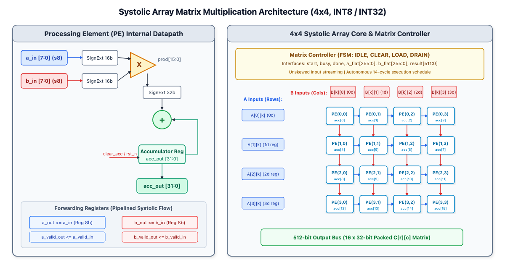
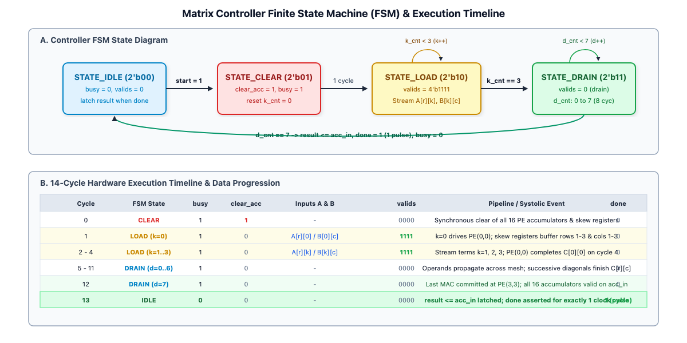
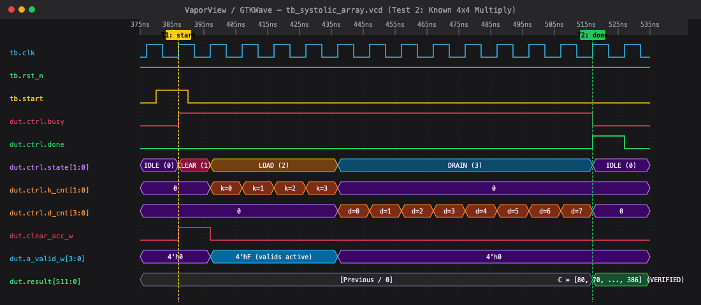
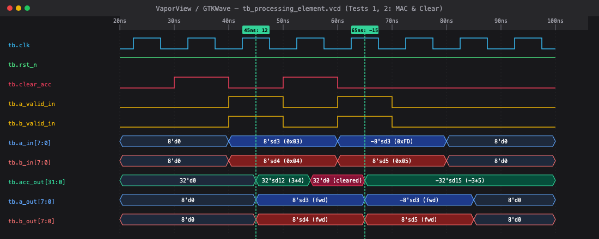

# Systolic Array Matrix Multiplication Accelerator (4×4 INT8 / INT32)

[](rtl/)
[](#how-to-build-and-run)
[](testbench/)
[](report/IEEE_Project_Report_Phase_1.pdf)

---

## Phase 1 Project Submission Artefacts

| Artefact | Description | Link |
|:---|:---|:---:|
| **IEEE Project Report (PDF)** | Formal 4-page IEEE conference format report with architectural block diagrams, verification tables, waveforms, and references | [**IEEE_Project_Report_Phase_1.pdf**](report/IEEE_Project_Report_Phase_1.pdf) |
| **Project Report (Markdown)** | Full GitHub-rendered markdown edition of the IEEE Project Report | [**REPORT.md**](report/REPORT.md) |
| **LaTeX Report Source** | IEEEtran conference format LaTeX source file | [**IEEE_Project_Report_Phase_1.tex**](report/IEEE_Project_Report_Phase_1.tex) |
| **Final Prototype Video** | 4:54.5 presentation in 1080p with all three members, recorded voiceovers, captions, an accumulation graph and report waveform close-ups | [**Watch / download final MP4**](docs/video/MCA_Final_With_Team_Voiceovers_1080p.mp4) |
| **Final Captions** | English subtitles synchronized to the recorded team narration | [**MCA_Final_Captions.srt**](docs/video/MCA_Final_Captions.srt) |
| **Video Script & Guide** | Project story, each member's dialogue and recording directions | [**TEAM_VIDEO_SCRIPT.md**](docs/TEAM_VIDEO_SCRIPT.md) |
| **Video Assets & Rebuild Guide** | Final video details, actual speaker timings, source files and rebuild instructions | [**Video README**](docs/video/README.md) |
| **Submission Form** | Official submission portal (Deadline: Nov 16, 2026, 11:59 PM) | [Google Form Submission](https://docs.google.com/forms/d/e/1FAIpQLSc6Cx8OrOQLGj_X2ZMkyG5jc8mokq36mGRq2x8jGRNV1sbegA/viewform) |

---

## Project Overview

The **Systolic Array Matrix Multiplication Accelerator** is an academic hardware design project aimed at designing, simulating, and verifying a high-throughput, energy-efficient General Matrix Multiply (GEMM) engine in Verilog HDL. 

Systolic arrays stream data rhythmically through a tightly-coupled 2D grid of Processing Elements (PEs), maximizing operand reuse and minimizing memory bandwidth bottlenecks (overcoming the Von Neumann "memory wall").

### Key Architectural Specifications
- **Array Dimensions:** 4×4 2D Mesh (16 Processing Elements).
- **Operand Precision:** Signed 8-bit integers (`INT8`, range $-128$ to $+127$).
- **Accumulator Precision:** Signed 32-bit integers (`INT32`) guaranteeing zero arithmetic overflow across successive accumulations.
- **Dataflow Architecture:** Output-Stationary (OS) with local PE accumulation and registered horizontal ($A$) and vertical ($B$) data forwarding.
- **Internal Skewing:** Embedded row and column skewing registers eliminate external timing alignment buffers, allowing unskewed parallel row/column streaming.
- **Deterministic Latency:** Exactly **14 clock cycles** from `start` assertion to registered `result` commitment.
- **Handshake Interface:** Simple memory-controller handshake using `start`, `busy`, and single-cycle `done` pulse.

---

## Hardware Architecture



1. **Processing Element (PE) (`rtl/processing_element.v`)**:
   - Computes $C_{r,c}^{(k)} = C_{r,c}^{(k-1)} + (A_{r,k} \times B_{k,c})$.
   - Sign-extends 8-bit inputs to 16 bits, performs $16 \times 16$ multiplication, and sign-extends to 32 bits for accumulation.
   - Dual registered forwarding channels pass $A$ horizontally and $B$ vertically with registered valid flags.
   - Synchronous `clear_acc` resets accumulators; asynchronous `rst_n` clears all state.

2. **Systolic Array Core (`rtl/systolic_array.v`)**:
   - Instantiates 16 PEs in a 4×4 mesh using nested generate loops.
   - Integrates perimeter skewing registers (delaying row $r$ by $r$ cycles and column $c$ by $c$ cycles).
   - Arrival timing: operand pair $(A_{r,k}, B_{k,c})$ arrives at $\text{PE}(r, c)$ at exact clock cycle $k + r + c$.

3. **Matrix Controller (`rtl/matrix_controller.v`)**:
   - 4-state FSM: `IDLE` (00) $\rightarrow$ `CLEAR` (01) $\rightarrow$ `LOAD` (10, $k=0..3$) $\rightarrow$ `DRAIN` (11, $d=0..7$) $\rightarrow$ `IDLE`.
   - Coordinates unskewed matrix feeding, valid gating, and result capture.

4. **Top-Level Integration (`rtl/systolic_array_top.v`)**:
   - Integrates controller and 2D array, exposing packed 256-bit matrix inputs (`a_flat`, `b_flat`), control handshakes, and 512-bit packed `result`.



---

## Team Members & Responsibilities

### **Member 1 — Aman Soni: Processing Element Design (Datapath RTL)**
**Domain:** Owns the basic computational unit.  
**Tasks Completed:**
1. Implemented the PE module in Verilog (`rtl/processing_element.v`).
2. Implemented signed 8-bit multiplication.
3. Implemented the 32-bit accumulator to eliminate arithmetic overflow.
4. Implemented clock and reset functionality.
5. Implemented $A$ and $B$ forwarding registers.
6. Implemented valid signals for data synchronization.
7. Wrote unit testbench (`testbench/tb_processing_element.v`) to verify individual PE operations (10/10 passed).  
**Files Created:** `rtl/processing_element.v`, `testbench/tb_processing_element.v`  
**Expected Output Delivered:** One fully functional PE that can correctly multiply and accumulate signed values and forward data to neighbouring PEs.

### **Member 2 — Mayank Sharma: Systolic Array Architecture (Hardware Integration)**
**Domain:** Owns the 16-PE network and data movement.  
**Tasks Completed:**
1. Instantiated 16 processing elements using nested `generate` loops.
2. Arranged them into a 4 × 4 2D grid.
3. Connected horizontal $A$ data paths.
4. Connected vertical $B$ data paths.
5. Connected valid signals between neighbouring PEs.
6. Implemented input skewing and timing alignment (delaying row $r$ by $r$ cycles and column $c$ by $c$ cycles).
7. Connected all 16 PE accumulators to the output matrix interface.  
**Files Created:** `rtl/systolic_array.v` (and core scoreboard `testbench/tb_systolic_array_core.v`).  
**Expected Output Delivered:** A correctly connected 4 × 4 systolic array in which data travels through the PEs and the multiply-accumulate operations happen at the correct scheduled cycle.

### **Member 3 — Ankit Kumar Pandey: Controller and Verification (Control RTL + Testing)**
**Domain:** Owns the complete operation from input matrices to verified results.  
**Tasks Completed:**
1. Implemented the input matrix registers/storage.
2. Implemented the controller state machine (`rtl/matrix_controller.v`).
3. Generated unskewed input streams for every PE row and column.
4. Generated the `start`, `busy`, and `done` handshake signals.
5. Implemented output collection and result-valid handling in `rtl/systolic_array_top.v`.
6. Developed self-checking top-level testbench (`testbench/tb_systolic_array.v`).
7. Created reference matrix multiplication model (`verification/golden_model.py`) and compared all 16 outputs.
8. Tested positive, negative, zero, and randomly generated matrices (40 test vectors).  
**Files Created:** `rtl/matrix_controller.v`, `rtl/systolic_array_top.v`, `testbench/tb_systolic_array.v`, `verification/golden_model.py`  
**Expected Output Delivered:** A complete, testable accelerator that receives two matrices, controls the array, produces the result, and verifies it against the correct answer.

---

## Verification Results Summary

### 1. Top-Level System Testbench (`testbench/tb_systolic_array.v`)
```bash
vvp simulation/results/top.vvp
```
```text
VCD info: dumpfile simulation/waveforms/tb_systolic_array.vcd opened for output.
PASS test 0: identity x M (I*M = M)
PASS test 1: zero x zero (all outputs 0)
PASS test 2: known positive 4x4 multiply
PASS test 3: signed extreme values (-128/127)
PASS test 4: mixed positive/negative values
PASS test 5: back-to-back op 1
PASS test 6: back-to-back op 2
PASS test 7: reset-during-operation recovery
PASS test 8: result stability
ALL TESTS PASSED (9 tests)
```

### 2. Processing Element Unit Testbench (`testbench/tb_processing_element.v`)
```bash
vvp simulation/results/pe.vvp
```
```text
PASS: Test 1 - Positive multiplication (3 * 4 = 12)
PASS: Test 2 - Negative multiplication (-3 * 5 = -15)
PASS: Test 3 - Both negative (-3 * -4 = 12)
PASS: Test 4 - Multiplication by zero
PASS: Test 5 - Multiple MAC operations (accumulated result = 29)
PASS: Test 6 - A invalid and B valid (accumulator unchanged)
PASS: Test 7 - A valid and B invalid (accumulator unchanged)
PASS: Test 8 - Accumulator clearing and MAC priority
PASS: Test 9 - Reset clears accumulator and forwarding registers
PASS: Test 10 - Correct forwarding of A, B and their respective valid signals
ALL 10 PE TESTS PASSED SUCCESSFULLY
```

### 3. Core-Level Cycle Scoreboard (`testbench/tb_systolic_array_core.v`)
```bash
vvp simulation/results/array.vvp
```
```text
PASS: 105 matrices, valid masks, bubbles, clear/reset/restart; 1533 edges checked
```

### 4. Algorithmic Python Golden Model (`verification/golden_model.py`)
```bash
python3 verification/golden_model.py
```
```text
Results: 40 PASSED, 0 FAILED out of 40 vectors
Wrote $readmemh file: verification/test_vectors/test_002_readmemh.hex
verify_verilog_output returned: PASS
All golden model checks PASSED.
```

---

## Waveform Evidence

### Top-Level Integration Waveform (Test 2: Known 4×4 Matrix Multiplication)

*Waveform capture from `simulation/waveforms/tb_systolic_array.vcd` demonstrating `start` trigger at 380 ns, deterministic transition through CLEAR, LOAD ($k=0..3$), and DRAIN ($d=0..7$), and single-cycle `done` pulse at 515 ns committing the verified result.*

### Processing Element MAC & Clear Waveform

*Waveform capture from `simulation/waveforms/pe.vcd` showing positive MAC ($3 \times 4 = 12$ at 45 ns), synchronous clear to zero at 55 ns, and negative MAC ($-3 \times 5 = -15$ at 65 ns).*

---

## How to Build and Run

### Prerequisites
- **Icarus Verilog** (`iverilog`, `vvp` v10.0+)
- **GTKWave** (for inspecting `.vcd` traces)
- **Python 3.8+**

### Step-by-Step Commands
```bash
# 1. Clone the repository
git clone https://github.com/MAYANKSHARMA01010/systolic-array-matrix-multiplication-accelerator.git
cd systolic-array-matrix-multiplication-accelerator

# 2. Compile and run Processing Element unit test
mkdir -p simulation/results simulation/waveforms
iverilog -g2005 -Wall -s tb_processing_element -o simulation/results/pe.vvp rtl/processing_element.v testbench/tb_processing_element.v
vvp simulation/results/pe.vvp

# 3. Compile and run 4x4 Array Core cycle scoreboard
iverilog -g2005 -Wall -s tb_systolic_array_core -o simulation/results/array.vvp rtl/processing_element.v rtl/systolic_array.v testbench/tb_systolic_array_core.v
vvp simulation/results/array.vvp

# 4. Compile and run Top-Level Integration testbench
iverilog -g2005 -Wall -s tb_systolic_array -o simulation/results/top.vvp \
    rtl/processing_element.v rtl/systolic_array.v rtl/matrix_controller.v rtl/systolic_array_top.v testbench/tb_systolic_array.v
vvp simulation/results/top.vvp

# 5. Run Python Golden Model & vector validation
python3 verification/golden_model.py

# 6. View simulation waveforms in GTKWave
gtkwave simulation/waveforms/tb_systolic_array.vcd
```

---

## References

1. H. T. Kung and C. E. Leiserson, "Systolic arrays (for VLSI)," in *Sparse Matrix Proceedings 1978*, I. S. Duff and G. W. Stewart, Eds. Philadelphia, PA, USA: SIAM, 1979, pp. 256–282. [Online]. Available: [https://apps.dtic.mil/sti/tr/pdf/ADA067674.pdf](https://apps.dtic.mil/sti/tr/pdf/ADA067674.pdf)
2. D. A. Patterson and J. L. Hennessy, *Computer Organization and Design RISC-V Edition: The Hardware/Software Interface*, 2nd ed. San Francisco, CA, USA: Morgan Kaufmann, 2020, ch. 4–6. [Online]. Available: [https://www.elsevier.com/books/computer-organization-and-design-risc-v-edition/patterson/978-0-12-812275-4](https://www.elsevier.com/books/computer-organization-and-design-risc-v-edition/patterson/978-0-12-812275-4)
3. N. P. Jouppi et al., "In-datacenter performance analysis of a tensor processing unit," in *Proc. 44th Annu. Int. Symp. Comput. Archit. (ISCA)*, Toronto, ON, Canada, Jun. 2017, pp. 1–12. [Online]. Available: [https://doi.org/10.1145/3079856.3080246](https://doi.org/10.1145/3079856.3080246)
