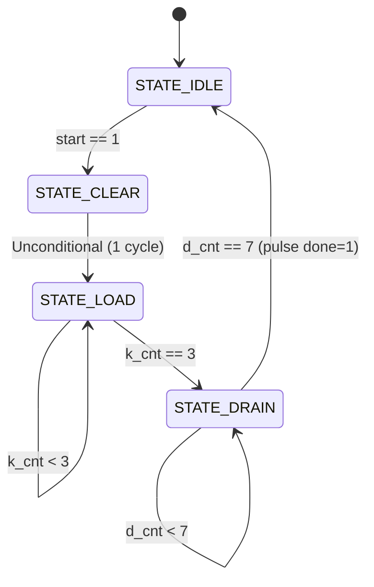

# Hardware Architecture Specification: 4×4 Systolic Array GEMM Accelerator

**Document Version:** 1.0  
**Phase:** 1  
**Authors:** Aman Soni, Mayank Sharma, Ankit Kumar Pandey  
**Institution:** Newton School of Technology, Sonipat  

---

## 1. System Overview

The accelerator performs high-throughput, fixed-dimension general matrix multiplication (GEMM) for two $4 \times 4$ matrices of signed 8-bit integers:
$$C_{4 \times 4} = A_{4 \times 4} \times B_{4 \times 4}$$

### 1.1 Key Parameter Summary
| Parameter | Value | Description |
|:---|:---:|:---|
| **Array Geometry** | $4 \times 4$ | 16 Processing Elements in a 2D mesh |
| **Input Precision** | Signed 8-bit (`INT8`) | Two's complement range: $[-128, +127]$ |
| **Intermediate Product** | Signed 16-bit (`INT16`) | Full-precision product of two 8-bit inputs |
| **Accumulator Precision** | Signed 32-bit (`INT32`) | Prevents overflow across successive accumulations |
| **Dataflow Paradigm** | Output-Stationary (OS) | Partial sums accumulate locally in each PE |
| **Compute Latency** | 14 clock cycles | Total duration from `start` to registered `done` |
| **Input Bandwidth** | 256 bits per matrix | Packed row-major container ($4 \times 4 \times 8$\,bits) |
| **Output Bandwidth** | 512 bits | Packed row-major container ($4 \times 4 \times 32$\,bits) |

---

## 2. Module Specifications

### 2.1 Processing Element (`rtl/processing_element.v`)
The Processing Element (PE) is the fundamental multiply-accumulate unit.

#### Pinout
| Signal | Direction | Width | Description |
|:---|:---:|:---:|:---|
| `clk` | Input | 1 | System rising-edge clock |
| `rst_n` | Input | 1 | Active-low asynchronous reset |
| `clear_acc` | Input | 1 | Synchronous clear of accumulator to zero |
| `a_in` | Input | 8 | Signed 8-bit operand from west |
| `b_in` | Input | 8 | Signed 8-bit operand from north |
| `a_valid_in` | Input | 1 | Valid flag for operand `a_in` |
| `b_valid_in` | Input | 1 | Valid flag for operand `b_in` |
| `a_out` | Output | 8 | Registered operand forwarded to east |
| `b_out` | Output | 8 | Registered operand forwarded to south |
| `a_valid_out` | Output | 1 | Registered valid flag forwarded to east |
| `b_valid_out` | Output | 1 | Registered valid flag forwarded to south |
| `acc_out` | Output | 32 | Local signed 32-bit accumulated sum |

#### Arithmetic Datapath
1. **Sign Extension:**
   ```verilog
   assign a_extended = {{8{a_in[7]}}, a_in};
   assign b_extended = {{8{b_in[7]}}, b_in};
   ```
2. **Multiplication:**
   ```verilog
   assign product = a_extended * b_extended;
   ```
3. **Accumulation:**
   ```verilog
   if (clear_acc) begin
       acc_out <= 32'sd0;
   end else if (a_valid_in && b_valid_in) begin
       acc_out <= acc_out + {{16{product[15]}}, product};
   end
   ```

---

### 2.2 Systolic Array Core (`rtl/systolic_array.v`)
Instantiates 16 PEs in a $4 \times 4$ mesh and manages internal input skewing.

#### Perimeter Skewing Delays
To accept unskewed inputs from the controller:
- **Row 0 / Column 0:** 0 delay stages (direct connection).
- **Row 1 / Column 1:** 1 flip-flop stage ($z^{-1}$).
- **Row 2 / Column 2:** 2 cascaded flip-flop stages ($z^{-2}$).
- **Row 3 / Column 3:** 3 cascaded flip-flop stages ($z^{-3}$).

Both operand data buses and valid lines pass through identical delay pipelines.

#### Interconnect Mesh
- Horizontal: `PE[r][c].a_out` connects to `PE[r][c+1].a_in`.
- Vertical: `PE[r][c].b_out` connects to `PE[r+1][c].b_in`.
- Accumulator: Each `PE[r][c].acc_out` routes directly to slice `acc_out[32*(4*r+c) +: 32]`.

---

### 2.3 Matrix Controller (`rtl/matrix_controller.v`)
Autonomous Mealy/Moore Finite State Machine orchestrating GEMM computation.

#### State Machine Flow


#### Detailed Execution Schedule
| Cycle | FSM State | Control Actions | Data Driven |
|:---:|:---:|:---|:---|
| **0** | `STATE_IDLE` $\to$ `STATE_CLEAR` | `busy=1`, `clear_acc=1`, reset counters | None |
| **1** | `STATE_LOAD` ($k=0$) | `clear_acc=0`, `valids=4'b1111` | $A[r][0]$ and $B[0][c]$ |
| **2** | `STATE_LOAD` ($k=1$) | `valids=4'b1111` | $A[r][1]$ and $B[1][c]$ |
| **3** | `STATE_LOAD` ($k=2$) | `valids=4'b1111` | $A[r][2]$ and $B[2][c]$ |
| **4** | `STATE_LOAD` ($k=3$) | `valids=4'b1111`, transition to DRAIN | $A[r][3]$ and $B[3][c]$ |
| **5–12** | `STATE_DRAIN` ($d=0..7$) | `valids=4'b0000`, operand propagation | Inactive |
| **13** | `STATE_IDLE` | `result <= acc_in`, `done=1` pulse, `busy=0` | Latched |

Total Latency: **14 clock cycles**.

---

### 2.4 Top-Level Accelerator (`rtl/systolic_array_top.v`)
Wraps the Matrix Controller and Systolic Array into a clean unified accelerator module with single-cycle handshake lines.
