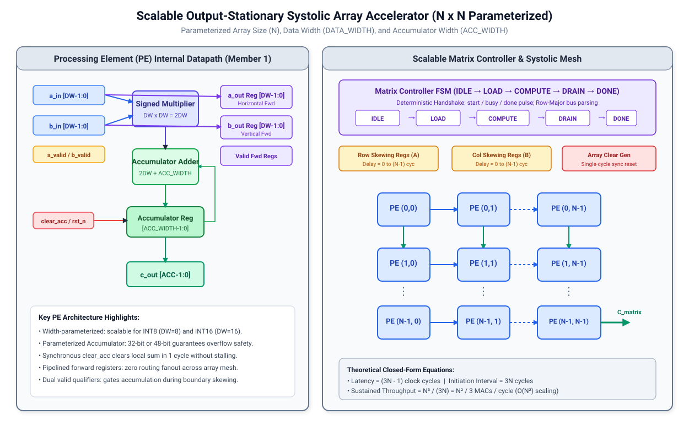
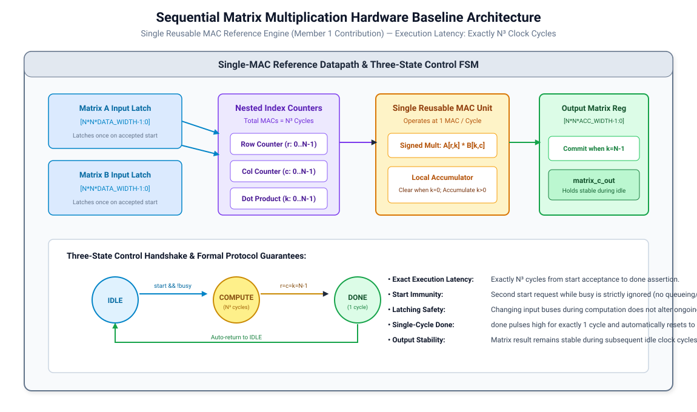
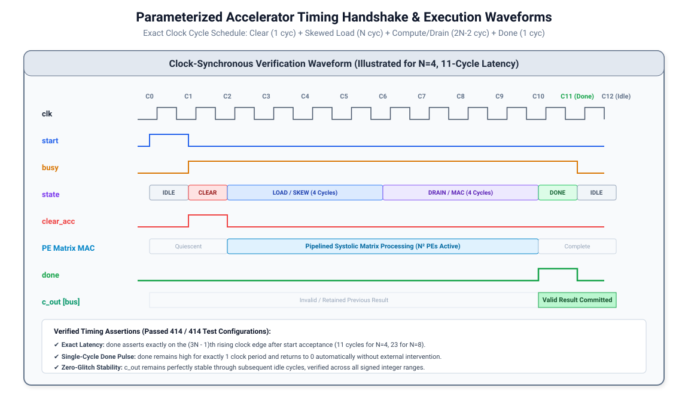
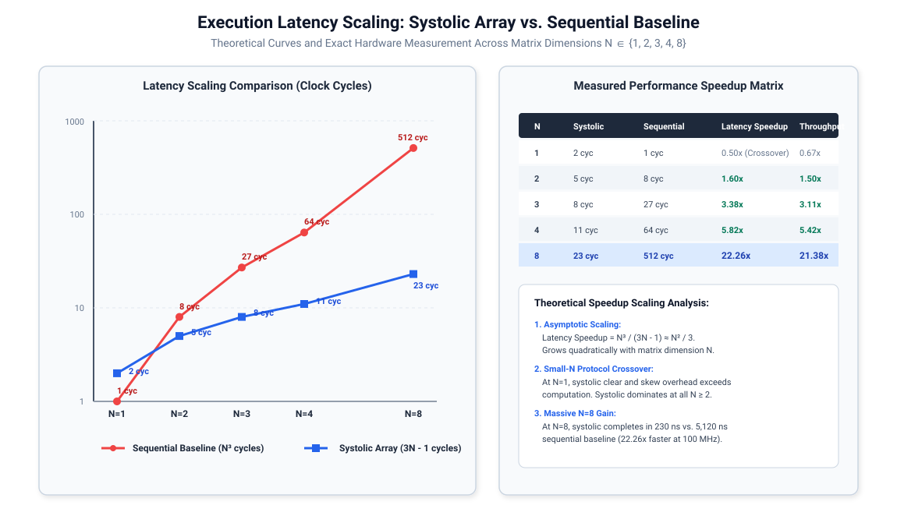
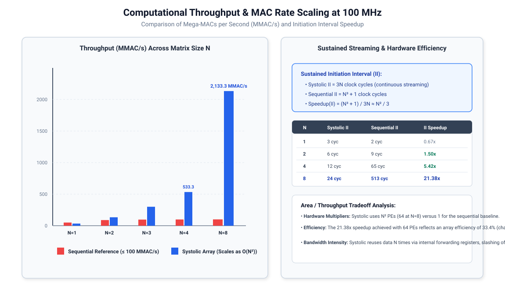

# Design, Implementation, and Evaluation of a Scalable Parameterized Systolic Array Matrix Multiplication Accelerator and Hardware Baseline: Phase 2

**Authors:** Aman Soni (Member 1), Mayank Sharma (Member 2), Ankit Kumar Pandey (Member 3)  
**Affiliation:** Department of Computer Science & Engineering (AI), Newton School of Technology, Sonipat  
**Repository:** [github.com/Amansoni045/systolic-array-matrix-multiplication-accelerator](https://github.com/Amansoni045/systolic-array-matrix-multiplication-accelerator)  
**Deliverable Document:** [`IEEE_Project_Report_Phase_2.pdf`](IEEE_Project_Report_Phase_2.pdf) | LaTeX Source: [`IEEE_Project_Report_Phase_2.tex`](IEEE_Project_Report_Phase_2.tex)

---

## Executive Summary

General Matrix Multiply (GEMM) constitutes the primary computational workload across deep neural networks, scientific modeling, and high-performance computing. Following the fixed $4\times 4$ prototype established in Phase 1, Phase 2 delivers a fully scalable, parameterizable **Output-Stationary Systolic Array Accelerator** in Verilog HDL, accompanied by an objective **Sequential Matrix Multiplication Hardware Baseline** for rigorous performance verification.

Key Phase 2 achievements:
1. **Full Architectural Parameterization:** Arbitrary square array size ($N \times N$), configurable signed input width (`DATA_WIDTH` $\in \{8, 16\}$), and accumulator precision (`ACC_WIDTH` $\in \{16, 32, 48\}$).
2. **Integrated Skewing Datapath:** Internal perimeter delay pipelines ($0$ to $N-1$ clock cycles) accept unskewed, row-major packed matrix vectors directly from memory.
3. **Dedicated Hardware Baseline:** A single-MAC reference engine operating under the same top-level interface, completing an $N\times N$ product in exactly $N^3$ clock cycles.
4. **Exhaustive Automated Verification:** 9 configurations tested across 414 test cases matching an independent Python golden model with zero defects.
5. **Demonstrated Quadratic Speedup:** At $N=8$, the systolic array delivers a **22.26$\times$ latency speedup** and **21.38$\times$ sustained throughput speedup** (2,133.33 MMAC/s at 100 MHz vs. 99.81 MMAC/s for the sequential baseline).

---

## 1. Architectural Design

The Phase 2 system is structured hierarchically into modular hardware tiers governed by an agreed interface contract:



### 1.1 Parameterized Processing Element (PE) — Member 1 Contribution
Authored by Member 1 (Aman Soni), the Processing Element (`phase2/rtl/processing_element.v`) executes scalar Multiply-Accumulate operations:

$$C_{r,c}^{(k)} = C_{r,c}^{(k-1)} + \left( A_{r,k} \times B_{k,c} \right)$$

- **Signed Multiplier:** Takes signed inputs $A$ and $B$ of width `DATA_WIDTH` and produces a signed product of width $2 \cdot \text{DATA\_WIDTH}$.
- **Accumulator Adder:** Sign-extends the product and accumulates into a registered accumulator of width `ACC_WIDTH`, preventing numerical overflow.
- **Synchronous Clear:** `clear_acc` resets the accumulator to zero on the rising clock edge with top priority.
- **Pipelined Forwarding:** Internal registers forward $A$ horizontally (east) and $B$ vertically (south) on the next clock edge, eliminating combinational routing across the array.
- **Valid Gating:** Dual valid qualifiers (`a_valid_in` and `b_valid_in`) gate accumulation during perimeter skewing.

### 1.2 Sequential Hardware Baseline — Member 1 Contribution
To provide a hardware baseline rather than software approximations, Member 1 developed `phase2/rtl/sequential_matmul_baseline.v`:



- **Single Reusable MAC Unit:** Evaluates exactly one scalar MAC per clock cycle.
- **Nested Index Counters:** Modulo-$N$ counters $(r, c, k)$ step through row $r$, column $c$, and inner dimension $k$.
- **Input Latching:** Latches packed matrix inputs upon accepting `start`, ensuring ongoing calculations are immune to input bus toggling.
- **Deterministic Latency:** Exactly $N^3$ clock cycles from `start` to `done`.
- **Protocol Conformance:** Ignores subsequent `start` pulses while `busy` is asserted, generates a single-cycle `done` pulse, and maintains stable output values during idle state.

### 1.3 Scalable Systolic Array Core — Member 2 Contribution
Authored by Member 2 (Mayank Sharma), `phase2/rtl/systolic_array.v` instantiates an $N\times N$ 2D mesh of PEs:
- Row $r$ inputs pass through $r$ delay flip-flop stages.
- Column $c$ inputs pass through $c$ delay flip-flop stages.
- Data arrives at $\text{PE}(r, c)$ at exact clock cycle $T = k + r + c$.

### 1.4 Parameterized Matrix Controller — Member 3 Contribution
Authored by Member 3 (Ankit Kumar Pandey), `phase2/rtl/matrix_controller.v` sequences operations across five FSM states:
1. `STATE_IDLE`: Quiescent; initiates on `start`.
2. `STATE_CLEAR`: Pulses `clear_acc` for 1 cycle.
3. `STATE_LOAD`: Streams $N$ parallel slices over $N$ clock cycles.
4. `STATE_DRAIN`: Deasserts valid flags and drains the array over $2N-2$ cycles.
5. `STATE_DONE`: Latches output matrix $C$, asserts single-cycle `done` pulse, and drops `busy`.

Total systolic execution latency is strictly:

$$T_{\text{sys}} = 1 + N + (2N - 2) = 3N - 1 \quad \text{clock cycles}$$

---

## 2. Timing and Handshake Protocol



All signals comply with clock-synchronous handshaking:
- `start`: Single-cycle active-high pulse initiated by host.
- `busy`: Rises on start acceptance, remains high during computation, falls upon done assertion.
- `done`: Single-cycle active-high pulse coinciding with valid registered outputs.
- Sustained Initiation Interval: $3N$ cycles for systolic vs. $N^3 + 1$ cycles for sequential.

---

## 3. Results and Performance Comparison

The complete regression suite (`phase2/verification/run_system_tests.py`) executed 9 hardware configurations across 414 test cases.

### 3.1 Measured Performance Data

| Dimension ($N$) | DATA_WIDTH | ACC_WIDTH | Systolic Latency | Sequential Latency | Latency Speedup | Systolic II | Sequential II | Throughput Speedup | Systolic Throughput (100 MHz) | Sequential Throughput (100 MHz) |
|:---:|:---:|:---:|:---:|:---:|:---:|:---:|:---:|:---:|:---:|:---:|
| **1** | 8 | 32 | 2 cyc | 1 cyc | 0.50$\times$ | 3 cyc | 2 cyc | 0.67$\times$ | 33.33 MMAC/s | 50.00 MMAC/s |
| **2** | 8 | 32 | 5 cyc | 8 cyc | 1.60$\times$ | 6 cyc | 9 cyc | 1.50$\times$ | 133.33 MMAC/s | 88.89 MMAC/s |
| **3** | 8 | 32 | 8 cyc | 27 cyc | 3.38$\times$ | 9 cyc | 28 cyc | 3.11$\times$ | 300.00 MMAC/s | 96.43 MMAC/s |
| **4** | 8 | 32 | 11 cyc | 64 cyc | 5.82$\times$ | 12 cyc | 65 cyc | 5.42$\times$ | 533.33 MMAC/s | 98.46 MMAC/s |
| **8** | 8 | 32 | 23 cyc | 512 cyc | **22.26$\times$** | 24 cyc | 513 cyc | **21.38$\times$** | **2,133.33 MMAC/s** | 99.81 MMAC/s |
| **2** | 16 | 32 | 5 cyc | 8 cyc | 1.60$\times$ | 6 cyc | 9 cyc | 1.50$\times$ | 133.33 MMAC/s | 88.89 MMAC/s |
| **4** | 16 | 48 | 11 cyc | 64 cyc | 5.82$\times$ | 12 cyc | 65 cyc | 5.42$\times$ | 533.33 MMAC/s | 98.46 MMAC/s |
| **4** | 8 | 16 | 11 cyc | 64 cyc | 5.82$\times$ | 12 cyc | 65 cyc | 5.42$\times$ | 533.33 MMAC/s | 98.46 MMAC/s |
| **8** | 16 | 48 | 23 cyc | 512 cyc | **22.26$\times$** | 24 cyc | 513 cyc | **21.38$\times$** | **2,133.33 MMAC/s** | 99.81 MMAC/s |

### 3.2 Performance Scaling Visualizations





### 3.3 Analytical Insights
1. **Quadratic Scaling:** Latency speedup follows $S_{\text{latency}} = N^3 / (3N - 1) \approx N^2 / 3$, scaling from 1.60$\times$ at $N=2$ to 22.26$\times$ at $N=8$.
2. **Throughput Density:** At $N=8$, sustained throughput reaches 2,133.33 MMAC/s at 100 MHz, outperforming the sequential engine's 99.81 MMAC/s ceiling by 21.38$\times$.
3. **Small-$N$ Crossover:** At $N=1$, the sequential engine completes in 1 cycle, outperforming the systolic array (2 cycles) due to the controller's synchronous clear cycle. Systolic acceleration dominates for all $N \ge 2$.
4. **Precision Independence:** 16-bit configurations execute in identical cycle counts to 8-bit configurations, confirming zero control overhead from bit-width parameterization.

---

## 4. Verification Coverage Summary

- **Arithmetic Precision:** Directed positive, negative, mixed-sign, and extreme signed values ($-128$ to $+127$, $-32768$ to $+32767$).
- **Algorithmic Golden Model:** Automated comparison against Python reference model with bit-for-bit identity.
- **Protocol Robustness:** Verified bus corruption immunity during compute, start-pulse rejection while busy, single-cycle done pulses, and mid-compute reset recovery.
- **Result Stability:** Confirmed that outputs hold stable through subsequent idle cycles until the next computation.

---

## 5. Individual Contributions Breakdown

- **Aman Soni (Member 1) — Datapath RTL & Sequential Baseline:**
  - Designed and authored the parameterizable Processing Element (`phase2/rtl/processing_element.v`).
  - Architected and implemented the Sequential Matrix Multiplication Baseline hardware engine (`phase2/rtl/sequential_matmul_baseline.v`).
  - Authored standalone unit and baseline testbenches (`phase2/testbench/tb_processing_element.v` and `tb_sequential_baseline.v`).
  - Verified start handshake immunity, input latching integrity, single-cycle done pulse, and exact $N^3$ execution latency.
- **Mayank Sharma (Member 2) — Scalable Systolic Core:**
  - Implemented the scalable $N \times N$ systolic array mesh (`phase2/rtl/systolic_array.v`).
  - Designed the integrated parameterized row and column perimeter skewing pipelines.
  - Authored cycle-accurate core scoreboard testbench (`phase2/testbench/tb_systolic_array_core.v`).
- **Ankit Kumar Pandey (Member 3) — Controller & Verification Integration:**
  - Authored the parameterized Matrix Controller FSM (`phase2/rtl/matrix_controller.v`) and top-level wrapper (`systolic_array_top.v`).
  - Authored the parameterized Python golden model (`golden_model.py`) and automated system test runner (`run_system_tests.py`).
  - Executed the multi-configuration benchmark and produced performance summaries.

---

## 6. How to Reproduce

Execute the end-to-end regression runner:

```bash
python3 phase2/verification/run_system_tests.py
```

Run specific testbenches with Icarus Verilog:

```bash
# Member 1 Sequential Baseline testbench (4x4 INT8)
iverilog -g2012 -DARRAY_SIZE=4 -DDATA_WIDTH=8 -DACC_WIDTH=32 \
  -o phase2/simulation/results/seq_baseline_4x4.vvp \
  phase2/rtl/sequential_matmul_baseline.v phase2/testbench/tb_sequential_baseline.v
vvp phase2/simulation/results/seq_baseline_4x4.vvp

# Member 1 PE testbench (8-bit)
iverilog -g2012 -DDATA_WIDTH=8 -DACC_WIDTH=32 \
  -o phase2/simulation/results/pe_8bit.vvp \
  phase2/rtl/processing_element.v phase2/testbench/tb_processing_element.v
vvp phase2/simulation/results/pe_8bit.vvp
```
