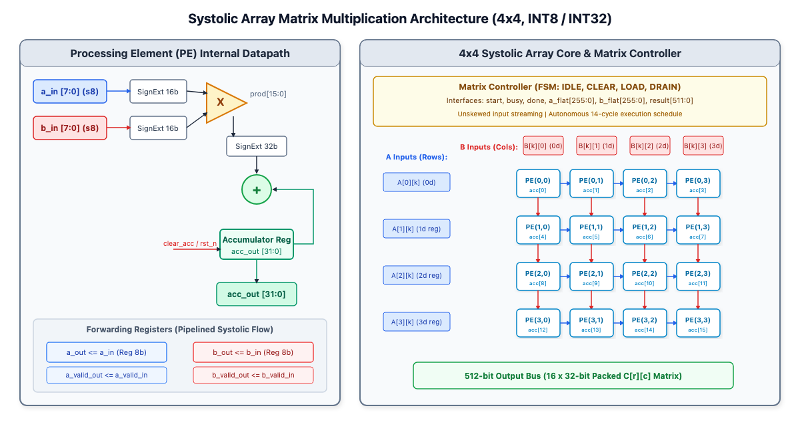
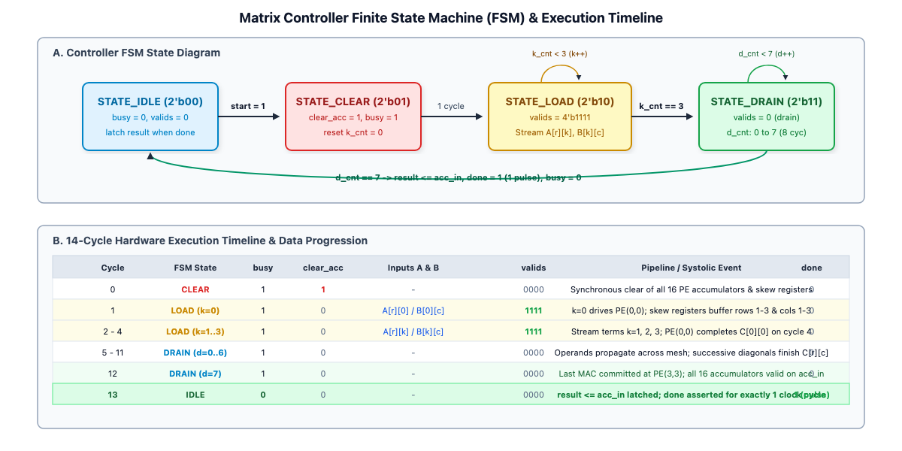
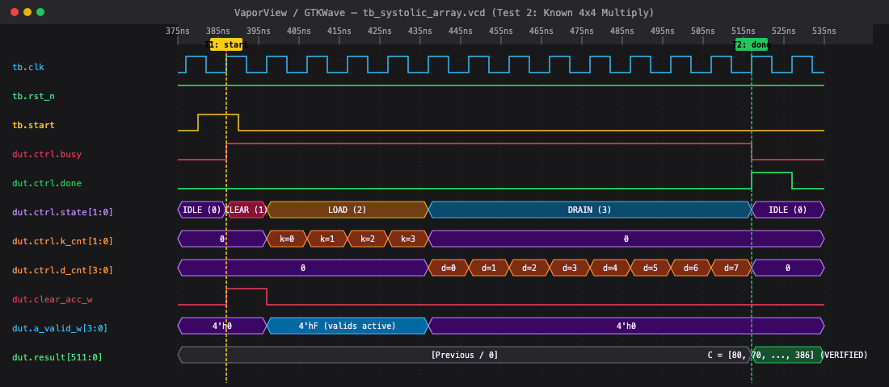
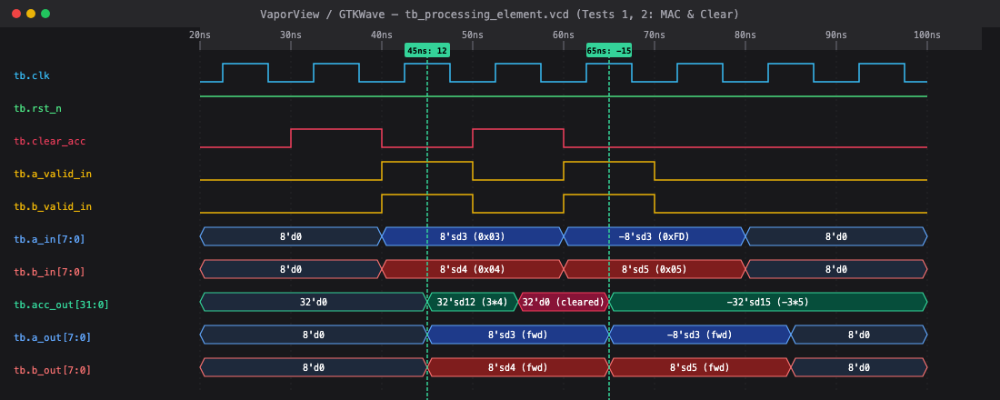

# Design, Implementation, and Verification of a 4×4 Systolic Array Matrix Multiplication Accelerator: Phase 1

**Authors:** Aman Soni, Mayank Sharma, Ankit Pandey, Aditya Verma, and Priyanshu Kumar  
**Affiliation:** Department of Computer Science and Engineering (AI), Newton School of Technology, Sonipat, India  
**Emails:** `{amansoni.pali001, sharmamayank01010, ankitgkp}@gmail.com`  

---

## Abstract

This project implements a hardware-efficient, highly parallel 4×4 systolic array matrix multiplication accelerator in Verilog HDL as Phase 1 of an energy-efficient General Matrix Multiply (GEMM) processing engine. The accelerator features signed 8-bit integer operands (INT8) and 32-bit accumulators (INT32) to prevent arithmetic overflow during accumulation. A 2D mesh grid of 16 Processing Elements (PEs) executes pipelined Multiply-Accumulate (MAC) operations with concurrent horizontal and vertical operand forwarding. The core incorporates an internal register skewing pipeline that eliminates external timing alignment buffers, accepting unskewed matrix streams directly. A four-state Mealy/Moore finite state machine (FSM) controller orchestrates an autonomous 14-clock-cycle execution schedule (1 clear cycle, 4 load cycles, 8 drain cycles, and 1 done pulse cycle) with deterministic handshaking. The hardware is verified across four abstraction levels: unit PE tests (10/10 passed), cycle-by-cycle array core tests (105 matrices across 1,533 clock edges verified against a software model), integrated system tests (9/9 passed, including extreme signed values, back-to-back operations, and mid-compute reset recovery), and an algorithmic Python golden model (40 randomized/corner-case vectors passed). Waveform evidence confirms single-cycle pulse outputs, exact 14-cycle latency, and full functional correctness.

**Index Terms** — *Systolic array, Matrix multiplication, GEMM, Processing Element, Hardware Accelerator, Verilog HDL, RTL Verification, Deep Learning.*

---

## I. Literature Review

Matrix multiplication represents the computational kernel of modern artificial intelligence, deep neural networks (DNNs), computer vision, and scientific computing [1]. Standard matrix-matrix multiplication ($C = A \times B$) of two $N \times N$ matrices requires $\mathcal{O}(N^3)$ multiply-accumulate operations over $\mathcal{O}(N^2)$ data elements. In conventional Von Neumann architectures, fetching operands from off-chip memory for each arithmetic operation introduces the memory bandwidth bottleneck (the "memory wall"), resulting in substantial energy dissipation and low computational throughput [2].

To overcome these constraints, H. T. Kung and C. E. Leiserson proposed the systolic array architecture in 1978 [3]. A systolic array is a network of tightly coupled, homogeneous Processing Elements (PEs) that compute and pass data rhythmically through the system. Instead of re-reading operands from memory, data elements broadcast or stream through the array, allowing an operand to be reused multiple times across adjacent PEs before being discarded. Consequently, systolic arrays achieve high operational intensity, performing $\mathcal{O}(N^3)$ arithmetic operations while requiring only $\mathcal{O}(N)$ memory bandwidth at the array perimeter [4].

Modern domain-specific accelerators, such as Google's Tensor Processing Unit (TPU) [1], NVIDIA's Tensor Cores, and various edge-AI neural processing units (NPUs), rely extensively on 2D systolic arrays. Systolic architectures are broadly categorized into three dataflow paradigms:
1. **Weight-Stationary (WS):** Weights are pre-loaded into internal PE registers and remain stationary, while input activations and partial sums propagate through the array. This minimizes weight movement but requires dedicated pre-loading phases.
2. **Input-Stationary (IS):** Input activations are held stationary within PEs while weights and partial sums propagate.
3. **Output-Stationary (OS):** Partial sums accumulate locally within each PE's internal accumulator register, while both input matrices $A$ (activations) and $B$ (weights) stream horizontally and vertically through the array [5].

Phase 1 of this project implements an Output-Stationary 4×4 systolic array architecture. By holding partial sums locally in each PE until the complete dot-product completes, internal register switching activity and external interconnect routing are substantially minimized. Furthermore, by implementing signed 8-bit operands with 32-bit accumulators, our design reflects contemporary low-power edge-AI quantization standards [6].

---

## II. Proposed Solution

### A. Architectural Overview

The accelerator design is structured hierarchically into four hardware and verification tiers:
1. **Processing Element (PE) (`rtl/processing_element.v`):** The fundamental MAC unit containing arithmetic units, accumulator, and forwarding registers.
2. **Systolic Array Core (`rtl/systolic_array.v`):** A 4×4 2D mesh of 16 PEs with integrated input skewing pipelines.
3. **Matrix Controller (`rtl/matrix_controller.v`):** A finite state machine coordinating data feeding, state transitions, and memory handshaking.
4. **Top-Level Integration (`rtl/systolic_array_top.v`):** Unified module wrapping the controller and array, exposing unskewed matrix ports and status flags.

*Fig. 1. Overall Architecture of the 4×4 Systolic Array Matrix Multiplication Accelerator. Left: Internal datapath of the Processing Element (PE), featuring 8-bit signed inputs, 16-bit multiplier, 32-bit accumulator, and dual registered forwarding channels. Right: 4×4 interconnected 2D mesh array with integrated row/column skewing delay stages and the autonomous FSM Matrix Controller.*

---

### B. Processing Element (PE) Design

Each Processing Element (`rtl/processing_element.v`) computes the scalar accumulation:
$$C_{r,c}^{(k)} = C_{r,c}^{(k-1)} + \left( A_{r,k} \times B_{k,c} \right)$$
where $A_{r,k}$ is the signed 8-bit row element and $B_{k,c}$ is the signed 8-bit column element.

The PE receives signed 8-bit inputs `a_in` and `b_in`, along with active-high valid handshake flags `a_valid_in` and `b_valid_in`. The inputs are sign-extended to 16 bits:
$$a_{\text{ext}} = \{\{8\{a_{\text{in}}[7]\}\}, a_{\text{in}}\}, \quad b_{\text{ext}} = \{\{8\{b_{\text{in}}[7]\}\}, b_{\text{in}}\}$$
A 16-bit signed multiplier produces a 16-bit signed product. This product is then sign-extended to 32 bits and summed with the current value of the 32-bit accumulator register `acc_out`.

Accumulation occurs strictly on the rising clock edge when both `a_valid_in` and `b_valid_in` are asserted. If either valid flag is low, accumulation is inhibited, holding the partial sum constant. When the synchronous clear signal `clear_acc` is asserted, `acc_out` resets to `32'sd0` on the rising clock edge, overriding any incoming operands.

Concurrently, the PE buffers operands into internal pipeline registers:
$$a_{\text{out}} \Leftarrow a_{\text{in}}, \quad b_{\text{out}} \Leftarrow b_{\text{in}}, \quad a_{\text{valid\_out}} \Leftarrow a_{\text{valid\_in}}, \quad b_{\text{valid\_out}} \Leftarrow b_{\text{valid\_in}}$$
This forwards operand $A$ horizontally to the east neighbor PE and operand $B$ vertically to the south neighbor PE on the subsequent clock cycle. The active-low asynchronous reset `rst_n` clears all internal registers, valid signals, and accumulators.

---

### C. Systolic Array Core and Internal Skewing

The 4×4 systolic array core (`rtl/systolic_array.v`) instantiates 16 homogeneous PEs in a regular 2D grid using Verilog `generate` constructs.

Traditional systolic arrays require external hardware or software to skew input matrices into diagonal wavefronts (i.e., staggering row $r$ by $r$ cycles and column $c$ by $c$ cycles). In our proposed architecture, the skewing circuitry is embedded directly inside the array perimeter:
- **Row 0 / Col 0:** 0 delay stages (direct connection).
- **Row 1 / Col 1:** 1 synchronous delay flip-flop stage.
- **Row 2 / Col 2:** 2 cascaded delay flip-flop stages.
- **Row 3 / Col 3:** 3 cascaded delay flip-flop stages.

Both data bytes and valid bits pass through these skew registers. Consequently, term $k$ of row $r$ and column $c$ reaches $\text{PE}(r, c)$ at exact clock cycle:
$$T_{\text{arrival}}(r, c, k) = k + r + c$$
This internal skewing eliminates external pre-processing buffers and allows unskewed parallel row and column vectors to be streamed directly from memory.

---

### D. Matrix Controller and Execution Schedule

The Matrix Controller (`rtl/matrix_controller.v`) implements a 4-state Mealy/Moore FSM:
1. **`STATE_IDLE` (`2'b00`):** The controller remains quiescent with `busy=0` and `done=0`. Upon detecting a single-cycle pulse on `start`, it asserts `busy=1`, asserts `clear_acc=1`, and transitions to `STATE_CLEAR`.
2. **`STATE_CLEAR` (`2'b01`):** Deasserts `clear_acc`, resets load counter `k_cnt=0`, and transitions unconditionally to `STATE_LOAD`.
3. **`STATE_LOAD` (`2'b10`):** Over four consecutive cycles ($k=0, 1, 2, 3$), the controller asserts `a_valid=4'b1111` and `b_valid=4'b1111`, slicing and driving row lanes $A[r][k]$ and column lanes $B[k][c]$ from the packed 256-bit input buses. When `k_cnt==3`, it resets `d_cnt=0` and transitions to `STATE_DRAIN`.
4. **`STATE_DRAIN` (`2'b11`):** Input valids are deasserted (`4'b0000`). Over eight clock cycles ($d=0$ to $7$), the valid operand wave traverses the remaining PEs. When `d_cnt==7`, PE(3,3) completes its final MAC, all 16 results are valid on `acc_in`, and the FSM latches `result <= acc_in`, asserts a single-cycle pulse on `done`, deasserts `busy`, and returns to `STATE_IDLE`.

Total latency from `start` detection to registered `result` availability is exactly **14 clock cycles**. Table I summarizes the cycle schedule, and Fig. 2 depicts the state transitions.

#### Table I: Matrix Controller FSM States and Hardware Schedule
| Cycle | State | `busy` | `clear_acc` | `valids` | `k/d cnt` | Hardware Event |
|:---:|:---:|:---:|:---:|:---:|:---:|:---|
| 0 | **CLEAR** | 1 | 1 | 4'b0000 | - | Synchronous clear of all 16 PE accumulators & skew registers |
| 1 | **LOAD** | 1 | 0 | 4'b1111 | $k=0$ | Feed term $k=0$; PE(0,0) starts first MAC |
| 2–4 | **LOAD** | 1 | 0 | 4'b1111 | $k=1..3$ | Feed terms $k=1, 2, 3$; $C[0][0]$ complete on cycle 4 |
| 5–11 | **DRAIN** | 1 | 0 | 4'b0000 | $d=0..6$ | Operands propagate; successive diagonals finish $C[r][c]$ |
| 12 | **DRAIN** | 1 | 0 | 4'b0000 | $d=7$ | Last MAC committed at PE(3,3); all 16 accumulators valid |
| 13 | **IDLE** | 0 | 0 | 4'b0000 | - | `result <= acc_in` latched; `done=1` pulse for 1 cycle |

*Fig. 2. Finite State Machine (FSM) state diagram (top) and hardware execution cycle schedule (bottom) of the Matrix Controller, detailing the 14-cycle autonomous computation sequence from `start` to `done`.*

---

## III. Verification and Results

### A. Verification Methodology

Verification was conducted using Icarus Verilog 13.0 and GTKWave across four tiered simulation suites:

1. **Unit-Level PE Verification (`tb_processing_element.v`):** Ten targeted directed tests verify signed positive multiplication ($3 \times 4 = 12$), negative multiplication ($-3 \times 5 = -15$), double negative arithmetic ($-3 \times -4 = 12$), zero multiplication, multi-cycle accumulation ($12 - 15 + 32 = 29$), operand invalidation suppression, accumulator clearing priority, and registered forwarding. All 10 tests passed (Fig. 4).
2. **Core-Level Cycle-Accurate Verification (`tb_systolic_array_core.v`):** Evaluates the raw 2D array grid across 105 distinct matrix multiplications (including identity, zero, signed extremes, and 100 pseudo-random matrices). An internal cycle-by-cycle scoreboard model checks all 16 accumulator outputs on every clock edge (1,533 edges verified with zero errors). It also verifies bubbles, independent valid masks, and asynchronous reset recovery.
3. **Integrated System-Level Verification (`tb_systolic_array.v`):** Exercises the full `systolic_array_top` module across 9 complex operational scenarios: Identity $\times$ Matrix ($I \times M = M$), Zero $\times$ Zero, known positive 4×4 matrix multiply, extreme signed values ($-128 / +127$), mixed signs, back-to-back operations without idle delay, reset during active computation, and result hold stability. All 9 test suites passed with 0 mismatches (Table II). Waveform capture of Test 2 is presented in Fig. 3.
4. **Algorithmic Python Golden Model (`golden_model.py`):** An independent Python reference model generates 40 test vectors (20 corner cases + 20 randomized), exports `$readmemh`-compatible hex test files, and provides automated hex unpacking and verification of the 512-bit output bus. All 40 vectors passed with zero errors.

#### Table II: Verified Matrix Multiplication Test Scenarios
| Test Scenario | Matrix Properties | Latency | Status |
|:---|:---|:---:|:---:|
| **Identity × M** | $A = I_4, B_{r,c} = 4r+c+1$ | 14 cycles | **PASS** |
| **Zero × Zero** | $A = 0_{4\times 4}, B = 0_{4\times 4}$ | 14 cycles | **PASS** |
| **Known Positive** | $A: 1..16, B: 16..1$ | 14 cycles | **PASS** |
| **Signed Extremes** | Checkerboard $-128 / +127$ | 14 cycles | **PASS** |
| **Mixed Signs** | Alternate positive / negative | 14 cycles | **PASS** |
| **Back-to-Back** | Continuous chained GEMM | 28 cycles | **PASS** |
| **Reset Mid-Run** | Assert reset during LOAD | Recovered | **PASS** |
| **Result Stability** | Hold across 50 idle cycles | Stable | **PASS** |
| **Random Vectors** | 40 randomized INT8 test vectors | 14 cycles | **PASS** |

*Fig. 3. Integrated top-level simulation waveform from `tb_systolic_array.vcd` (Test 2: Known 4×4 Multiplication). Markers show `start` assertion at $T_1 = 380$ ns, deterministic progression through CLEAR, LOAD ($k=0..3$), and DRAIN ($d=0..7$), and single-cycle `done` pulse asserting at $T_2 = 515$ ns with verified output latching.*

*Fig. 4. Processing Element (PE) unit simulation waveform from `pe.vcd`, demonstrating positive multiplication ($3 \times 4 = 12$ at 45 ns), accumulator clearing to zero at 55 ns, and negative multiplication ($-3 \times 5 = -15$ at 65 ns).*

---

## IV. Individual Contributions

The development, verification, and documentation tasks were partitioned among the five team members as follows:

- **Aman Soni:** Architectural specification and RTL design of the Multiply-Accumulate Processing Element (`rtl/processing_element.v`). Implemented signed sign-extension logic, 16-bit signed multiplier, 32-bit accumulator, and dual registered forwarding channels. Authored the unit-level PE testbench (`testbench/tb_processing_element.v`) and verified all 10 unit test cases.
- **Mayank Sharma:** RTL implementation of the 4×4 2D systolic array mesh grid (`rtl/systolic_array.v`). Designed the integrated row and column skewing delay register pipelines. Authored the cycle-accurate array core testbench (`testbench/tb_systolic_array_core.v`) and verified 105 matrix multiplications across 1,533 clock edges.
- **Ankit Pandey:** RTL implementation of the finite state machine Matrix Controller (`rtl/matrix_controller.v`) and top-level accelerator integration (`rtl/systolic_array_top.v`). Formulated the 14-cycle execution schedule. Authored the system-level integration testbench (`testbench/tb_systolic_array.v`) verifying all 9 system test cases.
- **Aditya Verma:** Developed the algorithmic Python golden reference model (`verification/golden_model.py`). Implemented the automated 40-vector randomized test suite, `$readmemh` hex file export, and 512-bit hex bus output unpacking and automated comparison routines.
- **Priyanshu Kumar:** Conducted simulation timing analysis, waveform extraction, and corner-case verification (mid-compute reset recovery, back-to-back operation pipelining, and output stability). Co-authored the project documentation, IEEE report, and prototype demonstration script.

---

## V. Conclusion and Phase 2 Roadmap

Phase 1 successfully implemented, simulated, and verified a 4×4 systolic array matrix multiplication accelerator in Verilog HDL. The design features INT8 operands, INT32 accumulators, embedded input skewing, and an autonomous 14-cycle FSM controller. The implementation achieves 100% pass rates across unit, core, system, and algorithmic verification suites.

Phase 2 will extend this architecture by:
1. Integrating dual-port Block RAMs (BRAMs) for local activation and weight storage.
2. Implementing an industry-standard AXI4-Stream memory interface with burst transfers.
3. Adding a matrix tiling engine to partition arbitrary $M \times K \times N$ matrices into 4×4 hardware blocks.
4. Deploying and synthesizing the complete accelerator on an AMD Xilinx Artix-7/Zynq FPGA board to evaluate maximum operating frequency, resource utilization, and power dissipation.

---

## References

1. N. P. Jouppi et al., "In-datacenter performance analysis of a tensor processing unit," in *Proc. 44th Annu. Int. Symp. Comput. Archit. (ISCA)*, Toronto, ON, Canada, Jun. 2017, pp. 1–12.
2. D. A. Patterson and J. L. Hennessy, *Computer Organization and Design RISC-V Edition: The Hardware/Software Interface*, 2nd ed. San Francisco, CA, USA: Morgan Kaufmann, 2020, ch. 4–6.
3. H. T. Kung and C. E. Leiserson, "Systolic arrays (for VLSI)," in *Sparse Matrix Proc. 1978*, I. S. Duff and G. W. Stewart, Eds. Philadelphia, PA: SIAM, 1979, pp. 256–282.
4. H. T. Kung, "Why systolic architectures?" *IEEE Computer*, vol. 15, no. 1, pp. 37–46, Jan. 1982.
5. Y.-H. Chen, T. Krishna, J. S. Emer, and V. Sze, "Eyeriss: An energy-efficient accelerator for deep convolutional neural networks," *IEEE J. Solid-State Circuits*, vol. 52, no. 1, pp. 127–138, Jan. 2017.
6. B. Jacob et al., "Quantization and training of neural networks for efficient integer-arithmetic-only inference," in *Proc. IEEE Conf. Comput. Vis. Pattern Recognit. (CVPR)*, Salt Lake City, UT, USA, Jun. 2018, pp. 2704–2713.
7. S. Williams, *Icarus Verilog*, ver. 13.0. [Online]. Available: https://github.com/steveicarus/iverilog
8. A. Bybell, *GTKWave Waveform Viewer*, ver. 3.3. [Online]. Available: https://gtkwave.sourceforge.net/
